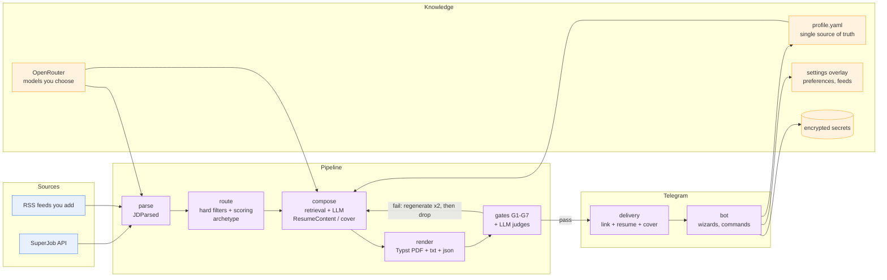

# jobharness

Local-first contractor job-search assistant, driven from Telegram. You fill in a profile once; it searches for jobs that fit (SuperJob API and RSS feeds you add), writes a tailored resume and cover letter for each good match, checks them for truthfulness, and sends you the job link, the resume and the cover letter in the chat. Nothing is ever sent to an employer.

Full spec: [`spec.md`](spec.md). Decisions: [`docs/decisions/`](docs/decisions/) (legacy log: [`docs/DECISIONS.md`](docs/DECISIONS.md)). Daily use: [`docs/RUNBOOK.md`](docs/RUNBOOK.md).

## Quickstart (10 steps)

> You need Docker (or Python 3.12 + `uv` + the `typst` binary), a Telegram account, an [OpenRouter](https://openrouter.ai) key and, optionally, a SuperJob application key.

1. **Create the bot.** In Telegram, talk to @BotFather: /newbot. Keep the token it gives you.
2. **Find your Telegram user id** (message @userinfobot). Only this user can use the bot.
3. **Generate the master key** that encrypts the keys you paste later:
   ```bash
   python -c "from cryptography.fernet import Fernet; print(Fernet.generate_key().decode())"
   ```
4. **Create `.env`** from `.env.example` with `TELEGRAM_BOT_TOKEN`, `TELEGRAM_OWNER_ID` and `JH_MASTER_KEY`.
5. **Start it.**
   ```bash
   docker compose up -d --build        # or: uv sync && uv run jh bot run
   uv run jh doctor                    # lists any missing environment variable
   ```
6. **Open your bot in Telegram** and send `/start`, then `/profile_start`. Answer the questions; every statement on your resume comes only from what you type.
7. **Set preferences:** `/preferences` (rate, hours, timezone, countries, display options).
8. **Connect OpenRouter:** `/connect openrouter`, paste the key (the message is deleted at once), then choose models with `/models set parse <model-id>` (also `classify`, `compose`, `judge`).
9. **Add job sources:** `/connect superjob` (paste the key) and/or `/feed_add <rss-url>`.
10. **Start the search:** `/run`. Check `/status` any time; stop with `/pause`.

That is the whole loop. Each matching job arrives as a message with the link, a resume file and a cover letter; press Applied or Skip to keep the list tidy.

## Architecture



## Telegram commands

| Group | Commands | Notes |
|---|---|---|
| Start | `/start` · `/help` · `/back` · `/skip` · `/cancel` | `/back`, `/skip`, `/cancel` work inside any question flow. |
| Profile | `/profile_start` · `/profile` · `/profile_identity` · `/profile_summary` · `/profile_role` · `/profile_education` · `/profile_skills` · `/profile_disclosure` · `/profile_export` | Guided setup, then edit one part at a time. |
| Preferences | `/preferences` | Rate, hours, timezone, countries, employer/title display, search interval. |
| Providers | `/providers` · `/connect` · `/disconnect` · `/models` | Keys are deleted from the chat and stored encrypted. |
| Sources | `/feeds` · `/feed_add` · `/feed_remove` | You confirm each feed's terms allow automated reading. |
| Run | `/run` · `/pause` · `/search_now` · `/status` | The search state survives restarts. |

## CLI reference

| Group | Commands | Notes |
|---|---|---|
| Setup | `jh init` · `jh doctor` | `doctor` reports missing environment variables by name. |
| Bot | `jh bot run` | Long polling; no public URL needed. |
| Pipeline | `jh pipeline run-once` | One search cycle without Telegram delivery. |
| Profile | `jh profile validate` · `jh profile lint` · `jh profile show` | For the CLI flow with `config/profile.yaml`. |
| Ingest | `jh ingest run --source {rss,email_alerts,superjob}` · `jh job add` | |
| Parse / Route | `jh parse run` · `jh route run --explain JOB_ID` | |
| Eval | `jh eval run --suite {router,claims,all}` · `jh eval doc DOC_ID` | `all` exits non-zero on regression. |

## Safety constraints (from spec §2, non-negotiable)

1. **Truthfulness.** All resume/cover content MUST be derivable from the profile. No invented employers, titles, dates, degrees, certifications, technologies, metrics or references. Gate G1 blocks any document with an unsupported claim.
2. **Positioning is selection, not falsification.** Allowed: choosing which true achievements to show, limiting the detailed window, anonymizing an employer by a truthful descriptor you wrote. Forbidden: changing a title level, shifting dates, hiding gaps misleadingly, claiming skills not in the profile.
3. **Nothing goes to employers.** The bot only sends to you. You apply yourself; there is no automated submission.
4. **Platform terms.** No CAPTCHA bypass, no fingerprint evasion, no fake accounts, no bulk form submission. Each source records its terms in `docs/SOURCES.md`; the SuperJob terms are still unverified there.
5. **Owner only.** The bot answers one Telegram user id and ignores everyone else.
6. **Secrets.** Keys you paste are deleted from the chat immediately and stored encrypted (Telegram bot chats are not end-to-end encrypted). They are never logged or committed. Losing `JH_MASTER_KEY` means reconnecting.
7. **Privacy.** Your profile text and job descriptions are sent to OpenRouter and the model provider behind the model you choose. No telemetry.
8. **Reproducibility.** Every generated document stores prompt version, model id, temperature and input hash.

## Out of scope (spec §21)

The system MUST NOT build: automated submission to platforms that forbid automation; CAPTCHA solving; account farming; ToS-violating scraping; false credentials/references/identity claims; features that conceal the Principal's identity after engagement or let someone else perform contracted work without written consent; automatic offer acceptance or contract signing; LinkedIn automation bots.

## Repository layout

`pyproject.toml`, `README.md`, `spec.md`, `Dockerfile`, `docker-compose.yml`, `.env.example`, `docs/` (decisions/, facts/, guardrails/, skills/, plans/, DECISIONS, SOURCES, PROMPTS, RUNBOOK), `config/` (config.example.yaml, profile.example.yaml, archetypes/, positioning.example.yaml), `src/jobharness/` (cli, settings, db/, schemas/, llm/, ingest/, parse/, route/, compose/, render/, eval/, bot/, pipeline/, secrets/), `tests/` (unit/, integration/, e2e/, fixtures/), `eval_data/` (golden_jobs/, golden_claims/, baselines/), `scripts/`, `.github/workflows/ci.yml`.

## Implementation status

The MVP plan is [`docs/plans/mvp.md`](docs/plans/mvp.md) (decision 0014). Email sending, inbox tracking, capacity planning, reports and a website are deferred.
